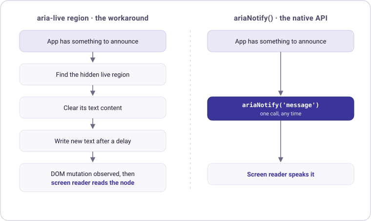
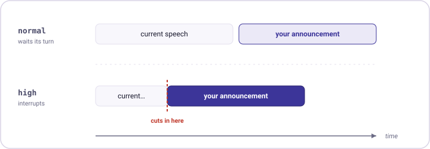
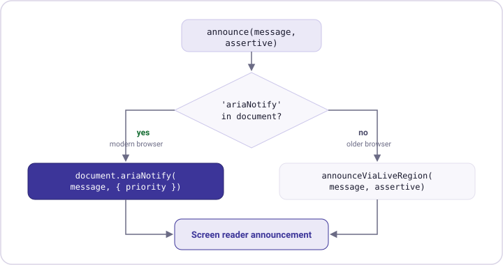

For years, getting a screen reader to say something at just the right moment meant fighting the DOM. You'd mount a hidden `aria-live` region when the page loaded, keep it alive no matter what your framework did to the surrounding markup, and then clear and rewrite its text content on a timer just to coax out a single announcement. It worked often enough to rely on, but it was fiddly, easy to break, and surrounded by edge cases. If you've read the companion piece on [why live regions fail silently in SPAs](/blog/2025-11-aria-live), you know exactly how many ways there are to get it wrong.

As of **September 2026**, there's a native browser API that makes most of that machinery unnecessary: [`ariaNotify()`](https://developer.mozilla.org/en-US/docs/Web/API/Element/ariaNotify). You call it, you pass a string, and the screen reader speaks. No hidden node, no mutation trick, no timing hacks. This article walks through what it does, how it maps onto the `aria-live` concepts you already know, where its sharp edges are, and how to adopt it today without leaving older browsers behind. It's deliberately framework-agnostic: everything here is the plain web platform API, so it applies whether you're working in Angular, Vue, React, or no framework at all.


## What `ariaNotify()` Actually Is

`ariaNotify()` lives on every DOM element (via `Element.prototype`) and on the `document` object, and it triggers a screen reader announcement directly, without any live region in sight. You can announce from a specific element when the message has a natural home, or from `document` when it's a global, app-level notification:

```js
// Announce from a specific element
buttonRef.ariaNotify('Settings saved successfully.');

// Or announce globally from the document
document.ariaNotify('Settings saved successfully.');
```

That single call replaces the entire hidden-live-region dance. There's no element to mount ahead of time, nothing to keep anchored in the DOM against your framework's re-renders, and no text content to clear and rewrite. The reason it can do this comes down to two properties that set it apart from live regions: a live region can only announce *after* a DOM change and reads out the content of the node that changed, whereas `ariaNotify()` can fire at any time and takes its announcement text as an argument, fully decoupled from whatever is (or isn't) in the DOM. The contrast is easiest to see side by side:



The [MDN reference](https://developer.mozilla.org/en-US/docs/Web/API/Element/ariaNotify) is blunt about it: the old pattern of a hidden node wired up to a live region is inefficient and error-prone, and `ariaNotify()` exists precisely to retire it.


## Normal vs. High Priority

If you've worked with `aria-live`, the mental model carries over almost unchanged. `ariaNotify()` takes an optional `priority` option with two urgency levels, and they line up directly with the politeness levels you already know:

```js
// Normal priority (the default): spoken after the screen reader
// finishes its current announcement.
document.ariaNotify('Draft saved.');
document.ariaNotify('Draft saved.', { priority: 'normal' });

// High priority: interrupts the current announcement immediately.
document.ariaNotify('Connection lost. Reconnecting…', { priority: 'high' });
```

| `ariaNotify()` priority | Equivalent `aria-live` | Use it for |
|-------------------------|------------------------|------------|
| `normal` (default)      | `polite`               | Most updates: saves, status changes, non-urgent feedback |
| `high`                  | `assertive`            | Critical, time-sensitive messages: errors, lost connections |

The difference is really about *timing* relative to whatever the screen reader is already saying:



The same discipline applies here as it does with live regions: `normal` should cover the vast majority of your announcements, and `high` is reserved for the things that genuinely can't wait. Interrupting whatever the screen reader is currently saying is a forceful move, and overusing it makes an app feel noisy and hostile to the people who depend on it. One subtlety worth filing away for pages that use both mechanisms: when an `aria-live` region and an `ariaNotify()` call are in play at the same time, the live region announcement wins.


## Language Selection

Because an announcement is spoken aloud, the screen reader needs to know which voice to use, meaning the accent and pronunciation, and it works that out from the `lang` attribute. `ariaNotify()` resolves the language from the `lang` on the element you call it on; if that element has none, it walks up to the nearest ancestor with a `lang`, and if there's nothing anywhere up the tree, it falls back to the user agent's default. So the voice follows the element:

```html
<div lang="de">
  <button id="save">Speichern</button>
</div>
```

```js
// Announced with a German voice, because the button inherits lang="de"
document.getElementById('save').ariaNotify('Entwurf gespeichert.');
```

This is a concrete, practical reason to keep `lang` accurate throughout your markup, and it matters most in multilingual apps where the announcement language should track the content language rather than the UI chrome. Keep in mind that announcing from `document` instead of a specific element hands the decision to the `<html>` element's `lang` (or the UA default), so your document's root language needs to be correct too.


## Permissions Policy Integration

One behavior that can catch you off guard is how `ariaNotify()` interacts with the [Permissions Policy](https://developer.mozilla.org/en-US/docs/Web/HTTP/Guides/Permissions_Policy). Usage can be governed by an `aria-notify` policy, and where a policy blocks it, most relevant inside an `<iframe>`, the call doesn't throw or warn. It simply does nothing: no announcement, no error, no signal of any kind. If your app can run embedded in someone else's frame, or you embed third-party content yourself, don't take a quiet call as a successful one. It may have been silently dropped.


## Don't Mix It With Live Regions

A question that comes up quickly is what happens around implicit live regions like `role="alert"`, which is equivalent to `aria-live="assertive"` with `aria-atomic="true"`. The key insight is that `ariaNotify()` and a live region are two separate announcement mechanisms with two separate triggers. A live region fires on a DOM mutation inside it, while `ariaNotify()` fires on the method call itself. Targeting an alert element with `ariaNotify()` is fine in itself, because an element with a role is firmly in the accessibility tree. The trouble starts when the same message travels through both channels at once:

```js
const alert = document.querySelector('[role="alert"]');

// Trigger 1: the DOM mutation fills the alert region, so the live region announces
alert.textContent = 'Connection lost.';

// Trigger 2: the call itself, so ariaNotify announces the same thing again
alert.ariaNotify('Connection lost.');
```

Here "Connection lost." can be spoken twice: once because the alert region saw its text change, and once because of the `ariaNotify()` call. It's the same double-speak trap people already hit when they pair `role="alert"` with `aria-describedby`. And the order isn't dependable either, because when both are in play the `aria-live` announcement takes precedence over the `ariaNotify()` one, so the region interrupts first and the notify call queues behind it.

The fix is to treat the two as alternatives rather than partners, and let a single mechanism own each message. If you need a visible alert that stays on screen, keep `role="alert"` and write the text into the DOM, with no `ariaNotify()` on top. If you only need the announcement and there's no visual live element to maintain, reach for `ariaNotify()` and drop the `role="alert"`, which is exactly the hidden-live-region case the API was built to replace. And if you want something both visible and reliably announced, render the container as a plain element without an implicit live-region role and drive the announcement through `ariaNotify()` alone, so there is only ever one source.


## Caveats and Good Behavior

Beyond the Permissions Policy, a few quirks are worth internalizing before you lean on `ariaNotify()` in production. The first is about *multiple* announcements. Some screen readers queue consecutive calls and read them in order, but that behavior isn't guaranteed across platforms. On many of them, only the most recent announcement is spoken and earlier ones are quietly discarded. The reliable approach, then, is to compose a single string instead of firing several calls in quick succession:

```js
// ❌ The first message may be dropped on some screen readers
document.ariaNotify('Item added.');
document.ariaNotify('Total is now € 29.99.');

// ✅ Reliable everywhere
document.ariaNotify('Item added. Total is now € 29.99.');
```

The second quirk is really a matter of restraint. Unlike many sensitive browser APIs, `ariaNotify()` doesn't require transient activation, meaning it fires without a user gesture, which makes it very easy to over-announce. That convenience is a trap: a steady stream of announcements is a far worse experience than the occasional missed one, so announce deliberately, not on every state tick. Third, mind where you call it: you can invoke `ariaNotify()` on almost any element, but browsers ignore calls on nodes they don't expose to the accessibility tree. That bar is about tree presence, not the tag name. A bare `<div>` or `<span>` with no role, no accessible name, and nothing semantic about it can be pruned from the tree just like `<html>` and `<body>`, and a call on such a node may be silently ignored. Give the same `<div>` a `role`, an `aria-label`, or meaningful content and it becomes a valid target again. The exact pruning rules vary by browser, so the safe habit is to call on `document`, which always works, or on an element you know is in the tree, such as an interactive control or one with an explicit role.

Finally, remember that reaching Baseline is only half the story, and it's worth being precise about why. When you call `ariaNotify()`, the browser hands the message to the operating system's accessibility layer, which forwards it to any assistive technology that's listening. That last hop, the screen reader actually voicing the message, is deliberately not guaranteed by the API, and there is no way to detect whether it happened. The call returns nothing, has no web-observable side effect, and must not reveal whether assistive technology is even present, which is a privacy decision so screen reader users can't be fingerprinted. The practical consequence is that a browser can fully support `ariaNotify()` while the installed screen reader quietly ignores the notification. Real-world coverage across the NVDA, JAWS, and VoiceOver matrix is still maturing, and JAWS in particular can update slowly, so as always with ARIA, test with actual assistive technology rather than trusting that a feature works because the method exists.


## Browser Support: Baseline Newly Available

The reason this is worth your attention now, rather than as a someday-feature, is timing. Chrome, Edge, and Firefox had already shipped `ariaNotify()`, and on **September 14, 2026** Safari 27 completed the set. That pushed the API to [Baseline Newly available](https://web.dev/baseline), meaning it's interoperable across all core browser engines.

That label is worth taking literally, because it shapes how you should adopt the feature. *Newly available* means every core browser supports it in its current version, so it's genuinely interoperable today, but a meaningful slice of your users will still be on older versions for a while yet. *Widely available* is the stricter bar a feature reaches after it's been interoperable long enough (roughly two and a half years) that you can reach for it without a second thought. `ariaNotify()` is at the first stage, not the second. That's a strong signal to start using it, but pairing it with a fallback is still the responsible move in production, which is exactly what the next section sets up.


## Adopting It Today: Progressive Enhancement

That maturing-support picture, Baseline *Newly available* rather than *Widely available* and with screen reader behavior still settling, points to a clear strategy. Rather than choosing between the shiny new API and the pattern you trust, use both: reach for `ariaNotify()` where it exists, and fall back to the proven global live region otherwise. A single call site, one feature check, two paths that reach the same outcome:



A small wrapper hides that branch so your call sites never have to think about it:

```js
function announce(message, assertive = false) {
  if ('ariaNotify' in document) {
    // Native path: modern browsers
    document.ariaNotify(message, {
      priority: assertive ? 'high' : 'normal',
    });
  } else {
    // Fallback: the global live region pattern
    announceViaLiveRegion(message, assertive);
  }
}
```

One honest caveat about this check: `'ariaNotify' in document` tests for *browser* support, and that's as far as it reaches. It can't tell you whether the screen reader is listening or will act on the notification, since none of that is observable from the page. So it closes one gap (browsers without the method) but leaves another open: a browser can support `ariaNotify()` while the user's screen reader ignores it. That's where keeping a live region in play earns its place, since `aria-live` has longer, more even screen reader support. Treat the fallback as a safety net for the whole chain from browser to screen reader.

The `announceViaLiveRegion()` fallback is exactly the global announcer from [the live region article](/blog/2025-11-aria-live): a persistently-mounted, visually-hidden region whose text content you clear and then rewrite to trigger the announcement. Mount the two regions once at app startup, and the fallback has somewhere to write:

```html
<!-- Mounted once, at app startup -->
<div id="aria-live-polite" class="sr-only" aria-live="polite" aria-atomic="true"></div>
<div id="aria-live-assertive" class="sr-only" aria-live="assertive" aria-atomic="true"></div>
```

```js
function announceViaLiveRegion(message, assertive = false) {
  const id = assertive ? 'aria-live-assertive' : 'aria-live-polite';
  const region = document.getElementById(id);
  if (!region) return;

  region.textContent = '';
  setTimeout(() => {
    region.textContent = message;
  }, 150);
}
```

With this in place you get the clean native behavior on modern browsers and the battle-tested fallback everywhere else, all behind a single `announce()` call with no branching leaking into your application code. And the nice part is that this is a transitional arrangement with a built-in exit: as the established announcer libraries (Angular CDK's `LiveAnnouncer`, `@vue-a11y/announcer`, `@react-aria/live-announcer`) adopt `ariaNotify()` under the hood, you'll inherit the browser-level enhancement for free just by keeping your dependencies current. They can only hedge the same browser-versus-browser gap you can, though, so the deeper reason to keep a live region around, uneven support on the screen reader side, stays true until that side of the matrix matures. Until then, the wrapper above is a small, portable piece you can drop into any codebase.


## When to Reach for `ariaNotify()` (and When Not To)

It's worth being clear about what `ariaNotify()` changes and what it doesn't. It replaces the *mechanism* of live regions, not the *judgment* around them, so every guideline about when announcing is appropriate still applies. It speaks plain text only, since no semantics and no interactive elements survive the trip, so a notification that contains a button the user must act on still belongs behind focus management, not an announcement. And the alternatives that were often better than a live region remain often better than an `ariaNotify()` call: moving focus for navigation changes and form errors, and letting ARIA state attributes like `aria-expanded`, `aria-pressed`, and `aria-selected` carry state changes on their own. Announcements, however they're triggered, should stay short, intentional, and infrequent. In other words, everything you learned about *when* to announce still holds. `ariaNotify()` just makes the *how* dramatically simpler.


## Conclusion

`ariaNotify()` is the native answer to a problem developers have worked around for years, trading the hidden live region, the DOM mutation trick, and the timing hacks for a single method call. The mental model stays familiar: `normal` priority behaves like `aria-live="polite"` and `high` like `assertive`, with `normal` the right default almost every time. The announcement voice follows the element's `lang`, so keep that accurate; and keep in mind that an `aria-notify` Permissions Policy can block calls silently, that multiple messages are best combined into one, and that the API's reach still depends on the screen reader honoring it. Because it's Baseline Newly available as of September 2026 rather than widely available, and because a feature check only proves the browser shipped the method and never that the screen reader will act on it, the pragmatic move today is to adopt it behind a small `announce()` wrapper that keeps a live region in play, so you get the modern path where it works and the proven one everywhere else.

If you haven't yet, read the companion piece on [why live regions break in SPAs](/blog/2025-11-aria-live). It's the foundation this API builds on, and the fallback you'll want while `ariaNotify()` matures toward Widely available.


## Further Resources

- [`Element.ariaNotify()`](https://developer.mozilla.org/en-US/docs/Web/API/Element/ariaNotify) on MDN: reference for the element-level method, including priorities, language selection, and the Permissions Policy.
- [`Document.ariaNotify()`](https://developer.mozilla.org/en-US/docs/Web/API/Document/ariaNotify) on MDN: the document-level variant, with a complete accessible shopping list example.
- [ARIA live regions](https://developer.mozilla.org/en-US/docs/Web/Accessibility/ARIA/ARIA_Live_Regions) on MDN: the mechanism `ariaNotify()` supersedes, still relevant as a fallback.
- [Baseline](https://web.dev/baseline) on web.dev: how the Newly available / Widely available stages work.
- [When Your Live Region Isn't Live](/blog/2025-11-aria-live): the companion article on fixing `aria-live` in Angular, Vue, and React.
